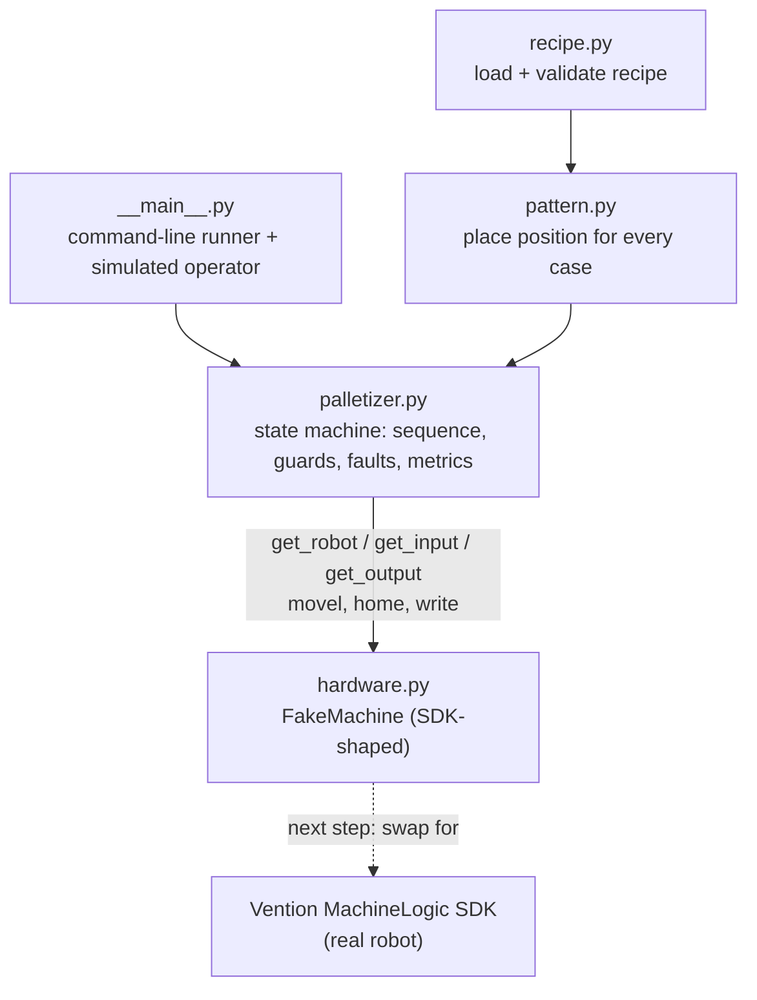
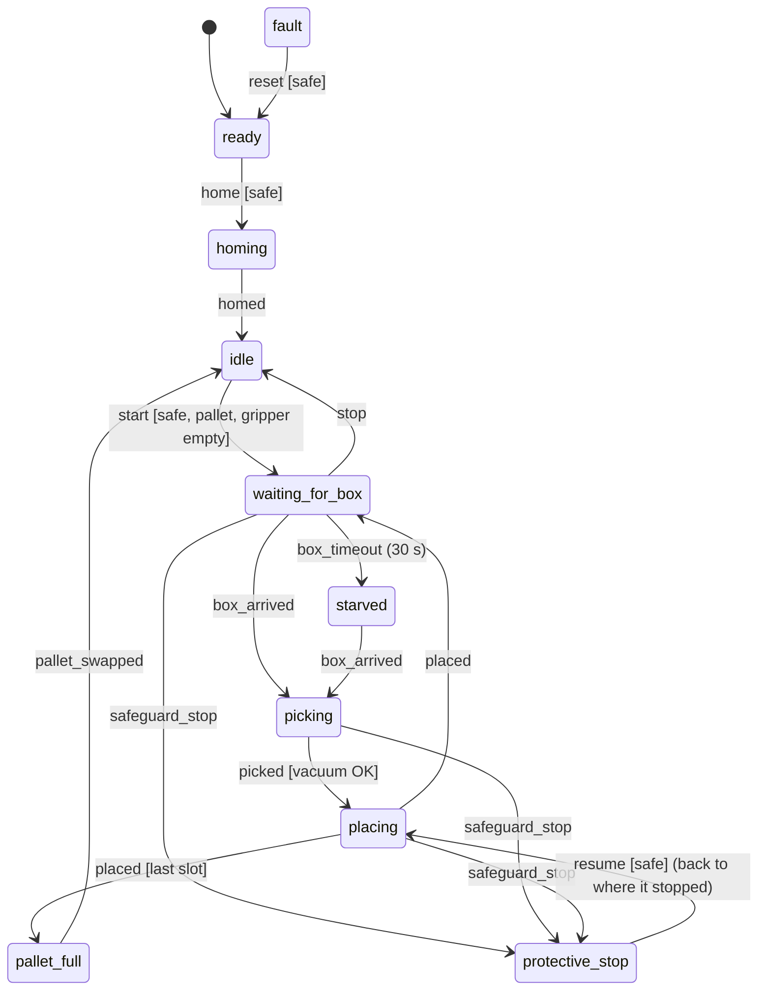

# Mini Palletizer

Control software for a **simulated single-robot palletizing cell**: a robot with a vacuum gripper
picks cases off an infeed conveyor and stacks them on a pallet, layer by layer. The demo recipe
palletizes 45 cereal cases (3 × 3 per layer, 5 layers).

It's structured the way Vention's Developer Toolkit structures a machine app: validated recipes,
a state machine that owns the sequence, faults and recovery, and a hardware layer shaped like the
MachineLogic SDK, so the logic can be tested in simulation before it touches a robot.

I built it in about a day to learn that approach, using AI pair programming (Claude) to speed up the
build. I reviewed every line, and the test suite checks the behaviour.

## Run it

```bash
python -m venv .venv
.venv\Scripts\activate          # Windows  (macOS/Linux: source .venv/bin/activate)
pip install -r requirements.txt

python -m minipal                          # full production run
python -m minipal --mode dry               # dry cycle: robot runs every move, no product
python -m minipal --fault safeguard@44     # light curtain broken mid-place -> protective stop -> resume
python -m minipal --fault estop@44         # E-stop while carrying a case -> fault -> recovery
python -m minipal --fault vacuum_loss@1    # vacuum never confirms at pick -> fault
python -m minipal --fault starve@20        # upstream stops feeding cases -> starved -> recovers
python -m minipal --speed 20               # watch it at 20x real time
pytest                                     # run the tests
```

A simulated operator handles the recovery steps (safety reset, Resume / Reset / Home / Start) so a
demo runs end to end. Each operator action is printed.

## Architecture



| Layer | File | Job |
|---|---|---|
| Recipe | `recipe.py` | Product data. Rejects bad recipes (overhang, overload, too tall) before anything moves, reporting every problem at once. |
| Pattern | `pattern.py` | Place position for each case in the pallet frame. Far row first, so the gripper never reaches over placed cases. |
| Logic | `palletizer.py` | State machine (built on `transitions`, the library Vention's framework wraps). |
| Hardware | `hardware.py` | Simulated robot, conveyor, vacuum and safety, with injectable faults. Same method names as the SDK. |
| Runner | `__main__.py` | Command line: recipe, mode, faults, speed. |

## State machine



`fault` can be entered from any state (E-stop, unknown safety state, vacuum loss).

## Design decisions

- **The app reacts to safety; it is never the safety system.** E-stops and light curtains belong to safety-rated hardware. The app watches the robot's safety state, stops commanding motion, and records where the cycle was interrupted.
- **Nothing restarts by itself.** When safety returns to NORMAL, the app does nothing until an operator acts. A safeguard stop needs a safety reset, then **Resume**, and continues from where it stopped. An E-stop needs a safety reset, then **Reset**, **Home** and **Start**, because position and cycle state can't be trusted.
- **UNKNOWN safety counts as unsafe.**
- **Illegal transitions are impossible by design.** There's no `fault → running` row in the table, so Start during a fault is rejected without any extra if-checks. Rejected commands are logged with the reason.
- **Guards encode commissioning checks**, e.g. you can't start with a case still on the gripper or with no pallet.
- **Vacuum stays on during a fault**, because dropping a held case is worse than holding it.
- **I/O handshakes:** the vacuum must confirm (`Vacuum OK`) before lifting, and waiting for a case has a timeout, like `WAIT DI[..]=ON TIMEOUT` on a FANUC.
- **Dry cycle vs production:** a dry cycle runs every move with no product and no vacuum, the software version of dry-cycling a cell before running material.
- **Metrics:** cycle time, cases per minute, starved time and stop causes, the same kind of data Vention's palletizer dashboard tracks.

## Next steps

1. **API:** expose `command()` as actions and `status()` as a live stream (FastAPI), the same split as Vention's communication library.
2. **Operator screen:** a React HMI with buttons, a state lamp, a visual twin of the pallet and a dashboard. The E-stop there would be labelled *Simulate E-stop*, since a real E-stop is hardwired.
3. **Real hardware:** replace `FakeMachine` with the MachineLogic SDK. `palletizer.py` already uses only SDK-shaped calls.
4. **More patterns:** interlocked or staggered layers, slip sheets, and a second pallet station.
5. **Recipes in a database** with an audit log of who changed what.
